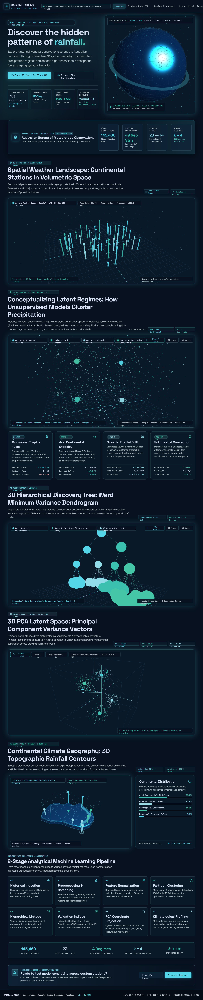

# Rainfall Atlas

### Natural Rainfall Regime Discovery from Historical Weather Patterns

Rainfall Atlas is a local, full-stack climate-data exploration application built around the **Rain in Australia (`weatherAUS.csv`)** dataset. It combines a Python/FastAPI analysis backend with a browser-based interface and Three.js visualizations to explore weather observations and investigate possible rainfall/climate patterns using unsupervised learning.

> **Important interpretation note:** The application is an exploratory clustering and visualization tool. Its clusters are statistical groupings of the selected observations; they are not official Australian climate classifications, rainfall forecasts, or causal explanations of weather. Some 3D scenes are conceptual illustrations. Refer to the limitations section before interpreting a visualization as an analytical result.



---

## Table of Contents

- [Features](#features)
- [Technology Stack](#technology-stack)
- [Repository Structure](#repository-structure)
- [Dataset](#dataset)
- [How the Analysis Works](#how-the-analysis-works)
- [Installation](#installation)
- [Run the Application](#run-the-application)
- [Run Tests](#run-tests)
- [API Reference](#api-reference)
- [Outputs and Experiment Registry](#outputs-and-experiment-registry)
- [Known Limitations](#known-limitations)
- [Security and Deployment Notes](#security-and-deployment-notes)
- [Acknowledgements and References](#acknowledgements-and-references)

---

## Features

### Dataset exploration and preprocessing

- Loads and validates `weatherAUS.csv`.
- Reports dataset dimensions, date coverage, location counts, missing-value percentages, duplicate Date–Location records, and rainfall distribution statistics.
- Assigns an observation identifier to support row tracking through the daily preprocessing workflow.
- Uses median imputation for selected numerical features.
- Optionally applies `log1p` to the `Rainfall` feature.
- Standardizes selected numerical features with `StandardScaler`.
- Provides a daily observation mode and an experimental location-monthly aggregation mode.

### Unsupervised clustering

- **K-Means:** Euclidean-distance partitioning with configurable cluster count and random seed.
- **K-Means evaluation:** evaluates a range of K values and reports WCSS/inertia, Silhouette Score, and Davies–Bouldin Index.
- **K-Means stability:** repeats K-Means with multiple random seeds and compares the resulting assignments and metrics.
- **Manhattan K-Medoids:** a custom sample-based, CLARA-inspired medoid routine using Manhattan (cityblock/L1) distance.
- **Agglomerative hierarchical clustering:** supports Ward, Complete, and Average linkage configurations, subject to valid linkage/distance combinations.
- **Dendrogram:** generates a hierarchical tree from the observations used in the hierarchical experiment.
- **Cross-model comparison:** provides cluster-assignment comparison measures such as Adjusted Rand Index (ARI) and Normalized Mutual Information (NMI) where the compared labels refer to the same observations.

### Analysis and visualization

- PCA projection into three principal components, including explained-variance information and feature loadings.
- Cluster profiles based on the selected observation data.
- Location-level summaries using the location coordinate lookup included with the project.
- Monthly, seasonal, and yearly summaries, plus daily transition analysis for consecutive dates in the same location.
- Browser interface with Three.js scenes for the globe, weather-station field, clustering concept, hierarchical concept, PCA point cloud, and Australian terrain.

---

## Technology Stack

| Layer | Technologies |
|---|---|
| Frontend | HTML, CSS, JavaScript, Tailwind CSS (CDN) |
| 3D visualization | Three.js (CDN) |
| Backend/API | Python, FastAPI, Uvicorn, Pydantic |
| Data processing | Pandas, NumPy |
| Machine learning | Scikit-learn, SciPy |
| Persistence | JSON and CSV experiment registry |
| Testing | Pytest, FastAPI TestClient |

The current frontend is served as a static HTML application by FastAPI. **A separate Node.js/npm build is not required** for the current implementation.

---

## Repository Structure

```text
RAINFALL-ATLAS/
├── backend/
│   ├── app/
│   │   ├── algorithms/
│   │   │   ├── comparison.py
│   │   │   ├── hierarchical.py
│   │   │   ├── kmeans.py
│   │   │   ├── kmedoids.py
│   │   │   └── pca.py
│   │   ├── api/
│   │   │   └── endpoints.py
│   │   ├── core/
│   │   │   ├── config.py
│   │   │   ├── constants.py
│   │   │   └── json_util.py
│   │   ├── preprocessing/
│   │   │   ├── data_loader.py
│   │   │   └── pipeline.py
│   │   ├── schemas/
│   │   │   └── schemas.py
│   │   ├── services/
│   │   │   ├── clustering_service.py
│   │   │   ├── experiment_registry.py
│   │   │   ├── geography_service.py
│   │   │   ├── profiling_service.py
│   │   │   └── temporal_service.py
│   │   └── main.py
│   ├── tests/
│   │   ├── test_api_endpoints.py
│   │   ├── test_backend.py
│   │   └── test_endpoints.py
│   └── requirements.txt
├── data/
│   └── weatherAUS.csv
├── outputs/
│   ├── experiments_registry.csv
│   ├── experiments_registry.json
│   ├── figures/
│   ├── models/
│   ├── processed/
│   └── tables/
├── static/
│   └── index.html
├── backup/                 # Preserved design/source backups, if retained
├── code.html               # Original Stitch-generated design source
├── DESIGN.md               # Design reference
├── screen.png              # Application screenshot
├── run.py                  # Cross-platform launcher
├── start.bat               # Windows launcher
└── README.md
```

`data/weatherAUS.csv` is the configured dataset location. The loader also checks for a root-level `weatherAUS.csv` as a fallback. Keep one canonical dataset copy where possible to avoid storing duplicate files in the repository.

---

## Dataset

**Dataset:** Rain in Australia (`weatherAUS.csv`)

**Source:** [Rain in Australia – Kaggle](https://www.kaggle.com/datasets/jsphyg/weather-dataset-rattle-package)

The dataset contains daily weather observations from Australian weather locations. The version currently used by this project has the following characteristics (the application also computes a summary from the CSV at startup):

| Dataset attribute | Value |
|---|---:|
| Rows in supplied CSV | 145,460 |
| Original data columns | 23 |
| Distinct `Location` values | 49 |
| Date coverage | 2007-11-01 to 2017-06-25 |

The principal numerical feature set configured in `backend/app/core/constants.py` is:

- `MinTemp`, `MaxTemp`, `Temp9am`, `Temp3pm`
- `Rainfall`
- `WindSpeed9am`, `WindSpeed3pm`
- `Humidity9am`, `Humidity3pm`
- `Pressure9am`, `Pressure3pm`

`RainTomorrow` is excluded from the clustering feature set. `RainToday` is also removed by the preprocessing pipeline. The `Location` field is retained as metadata for location-level analysis rather than being treated as an ordinary numeric feature.

### Dataset setup

The repository may include `data/weatherAUS.csv`. If it is not included in a clone or download:

1. Download the dataset from the [Kaggle source page](https://www.kaggle.com/datasets/jsphyg/weather-dataset-rattle-package).
2. Extract the CSV file.
3. Place it at:

   ```text
   data/weatherAUS.csv
   ```

The loader checks for the required `Date`, `Location`, and `Rainfall` columns. Do not rename these fields without updating the data-loading and analysis code.

Check the dataset's source-page terms before redistributing the CSV in another repository or project.

---

## How the Analysis Works

### 1. Loading and preprocessing

The backend loads the CSV, parses `Date`, assigns an `observation_id` when one is not already present, and prepares the selected numerical features. The configured pipeline uses median imputation, optional `log1p(Rainfall)`, and z-score standardization with `StandardScaler`.

The default core feature list contains 11 numerical variables. Optional numerical variables are declared separately in `backend/app/core/constants.py` and are not automatically part of the default core feature list.

### 2. K-Means

K-Means uses squared Euclidean distance and arithmetic centroids. The evaluation endpoint supports a range of cluster counts (default K=2 through K=8) and reports:

- WCSS/inertia (computed from the fitted model)
- Silhouette Score
- Davies–Bouldin Index
- Cluster counts and proportions

For large inputs, Silhouette and Davies–Bouldin calculations use an evaluation sample. The K-Means range evaluator uses one common sample for the K values in that evaluation call; check the response metadata and source code for the configured sample size.

### 3. K-Means stability

The stability routine repeats clustering for multiple seeds and compares assignments using ARI, alongside the variation in evaluation metrics. Stability indicates repeatability under the tested initializations; it does **not** prove that the clusters are objectively correct or represent official climate zones.

### 4. Manhattan medoid clustering

The K-Medoids module uses Manhattan/cityblock distance and a sample-based medoid optimization strategy to control pairwise-distance memory use. Its Manhattan Silhouette and Manhattan cost are distinct from K-Means WCSS. The reported Davies–Bouldin value is a supplementary **Euclidean** diagnostic; it should not be interpreted as a Manhattan-native Davies–Bouldin score.

### 5. Hierarchical clustering

Agglomerative clustering is evaluated on a subset of observations to keep the pairwise-distance workload manageable. Supported comparisons include:

- Ward with Euclidean distance
- Complete with Euclidean distance
- Complete with Manhattan distance
- Average with Euclidean distance
- Average with Manhattan distance

Ward linkage is associated with the Euclidean within-cluster variance criterion. Dendrograms describe the hierarchical sample used for the corresponding experiment; they do not automatically represent a full-data hierarchical fit.

### 6. PCA and downstream summaries

PCA is computed from the preprocessed/scaled feature matrix. The backend returns the principal-component coordinates, explained-variance information, and loadings used by the frontend. Location and temporal summaries are descriptive views of the selected labels and associated metadata.

---

## Installation

### Prerequisites

- Python 3.10 or newer
- `pip`
- A modern web browser
- Internet access for the frontend's externally hosted fonts, Tailwind CSS, and Three.js CDN assets

### Windows PowerShell

From the repository root:

```powershell
# Create a virtual environment
py -3 -m venv .venv

# Activate it
.\.venv\Scripts\Activate.ps1

# Upgrade pip
python -m pip install --upgrade pip

# Install backend dependencies
python -m pip install -r backend/requirements.txt
```

If PowerShell blocks activation, you can run the application using the virtual environment's Python executable directly:

```powershell
.\.venv\Scripts\python.exe -m pip install -r backend/requirements.txt
.\.venv\Scripts\python.exe run.py
```

### macOS / Linux

```bash
# Create and activate a virtual environment
python3 -m venv .venv
source .venv/bin/activate

# Install dependencies
python -m pip install --upgrade pip
python -m pip install -r backend/requirements.txt
```

---

## Run the Application

### Windows one-click launch

Double-click `start.bat`, or run:

```powershell
.\start.bat
```

The batch file checks for Python and launches `run.py`.

### Cross-platform launch

From the repository root, with the virtual environment activated:

```bash
python run.py
```

The launcher starts Uvicorn on:

```text
http://127.0.0.1:8000
```

It attempts to open the application in the default browser after the API information endpoint responds. The backend initializes the dataset and warms its analysis cache during startup; startup can therefore take longer than a simple static website.

### Application and API documentation

| Resource | URL |
|---|---|
| Rainfall Atlas web application | http://127.0.0.1:8000/ |
| API health | http://127.0.0.1:8000/api/health |
| API information | http://127.0.0.1:8000/api/info |
| Swagger UI | http://127.0.0.1:8000/docs |
| ReDoc | http://127.0.0.1:8000/redoc |

Stop the server with `Ctrl+C` in the terminal.

---

## Run Tests

Install the dependencies first, then run from the repository root:

```bash
python -m pytest backend/tests -q
```

For verbose output:

```bash
python -m pytest backend/tests -v
```

The test suite covers data loading, preprocessing, algorithm behavior, analytical services, and API endpoints. Test success confirms the covered code paths execute; it does not replace a scientific review of model assumptions, sampling design, or interpretation.

---

## API Reference

All application API routes use the `/api` prefix.

### Dataset and preprocessing

| Method | Endpoint | Purpose |
|---|---|---|
| GET | `/api/health` | Backend health and cache status |
| GET | `/api/info` | API information and endpoint pointers |
| GET | `/api/dataset/summary` | Dataset dimensions, dates, locations, missingness, rainfall summary |
| GET | `/api/dataset/features` | Available columns and recommended core features |
| GET | `/api/dataset/quality` | Data-quality summary |
| POST | `/api/preprocessing/configure` | Configure and initialize preprocessing |
| GET | `/api/preprocessing/summary` | Current preprocessing configuration |

### Clustering and comparison

| Method | Endpoint | Purpose |
|---|---|---|
| POST | `/api/clustering/kmeans` | Run K-Means |
| GET | `/api/clustering/kmeans/evaluate` | Evaluate K-Means across a K range |
| GET | `/api/clustering/kmeans/stability` | Evaluate K-Means across seeds |
| POST | `/api/clustering/kmedoids` | Run Manhattan medoid clustering |
| POST | `/api/clustering/hierarchical` | Run agglomerative hierarchical clustering |
| GET | `/api/clustering/hierarchical/compare_linkages` | Compare supported linkage configurations |
| POST | `/api/clustering/select` | Select the active cached model |
| GET/POST | `/api/clustering/compare` | Retrieve the model-comparison result |

### Results and experiments

| Method | Endpoint | Purpose |
|---|---|---|
| GET | `/api/results/metrics` | Active model metrics |
| GET | `/api/results/clusters` | Active cluster profiles |
| GET | `/api/results/profiles` | Cluster profile list |
| GET | `/api/results/pca` | PCA coordinates, variance, and related metadata |
| GET | `/api/results/dendrogram` | Cached Ward dendrogram data |
| GET | `/api/results/geography` | Location-level cluster summaries |
| GET | `/api/results/temporal` | Monthly, seasonal, yearly and transition summaries |
| GET | `/api/experiments` | Experiment registry entries |
| GET | `/api/experiments/{exp_id}` | Retrieve an experiment by ID |

Use the interactive Swagger documentation at `/docs` for request schemas and response examples.

---

## Outputs and Experiment Registry

The application writes experiment records to:

- `outputs/experiments_registry.json`
- `outputs/experiments_registry.csv`

The `outputs/figures/`, `outputs/models/`, `outputs/processed/`, and `outputs/tables/` directories are available for generated artifacts. Their contents depend on which operations have been run; an empty directory does not mean the corresponding output has already been generated.

---

## Known Limitations

- **Exploratory, not predictive:** The clustering pipeline does not forecast future rainfall and does not establish causal climate relationships.
- **Dataset coverage:** The supplied dataset is limited to the Australian locations and historical period represented in the CSV. Results should not be generalized to all Australian stations or global climates without additional data and validation.
- **Observation representation:** Daily-observation clusters may describe weather states rather than persistent long-term climate regimes. The location-monthly mode is an experimental aggregation option; the current preprocessing implementation aggregates selected numerical features by their mean. It should not be interpreted as monthly rainfall totals or rainy-day frequency unless those features are explicitly engineered.
- **K-Means assumptions:** K-Means uses Euclidean geometry and can be sensitive to scaling, outliers, feature selection, initialization, and the chosen K.
- **Sample-based validation:** Some Silhouette, Davies–Bouldin, K-Medoids, and hierarchical calculations use samples for computational feasibility. Their sample size and method should accompany any reported result.
- **Manhattan metric reporting:** Manhattan Silhouette/cost and Euclidean Davies–Bouldin are different diagnostics; do not treat them as a single metric family or compare their objective values directly with WCSS.
- **Hierarchical results:** The dendrogram and linkage comparison are based on a subset of the observations. Approximate assignments outside that sample, if used by a downstream view, must be distinguished from exact hierarchical labels.
- **3D scenes:** Several scenes are explanatory/conceptual visualizations. The particle convergence field and hierarchical tree illustration should not be confused with the fitted algorithms' exact geometry or a scientific dendrogram. Check each scene's data source before interpreting it as a live analytical plot.
- **Location coordinates:** The application uses a predefined location-coordinate lookup. Treat it as a visualization reference and verify coordinate provenance before using the map for high-precision geographic analysis.
- **Sampling and missingness bias:** Observation counts and missing-value rates differ across locations and variables. These differences can influence the apparent cluster proportions and interpretation.

---

## Security and Deployment Notes

The included launcher is intended for local development/demo use and binds to `127.0.0.1`. The current application does not provide user authentication, role-based access control, or production deployment hardening. Review CORS settings, input validation, resource limits, dataset upload handling, and access controls before exposing the service to a public network.

The frontend loads several assets from external CDNs, so those resources require internet access. For an offline or production deployment, vendor and pin those assets appropriately and review their licenses.

---

## Acknowledgements and References

- **Dataset:** [Rain in Australia – Kaggle](https://www.kaggle.com/datasets/jsphyg/weather-dataset-rattle-package)
- **Scikit-learn:** [Clustering documentation](https://scikit-learn.org/stable/modules/clustering.html) and [PCA documentation](https://scikit-learn.org/stable/modules/decomposition.html#pca)
- **SciPy:** [Hierarchical clustering documentation](https://docs.scipy.org/doc/scipy/reference/cluster.hierarchy.html)
- **FastAPI:** [Official documentation](https://fastapi.tiangolo.com/)
- **Three.js:** [Official documentation](https://threejs.org/docs/)

---

## License

No project-level `LICENSE` file is included in the current workspace. Add an explicit license file before granting permissions for reuse or redistribution. The dataset may have separate usage and redistribution terms; refer to its source page.

## Public Deployment (GitHub + Render)

See [DEPLOYMENT.md](DEPLOYMENT.md) for the exact GitHub publishing steps and Render configuration. This project includes a `render.yaml` Blueprint and a pinned `.python-version` file. The hosted dashboard uses same-origin `/api` requests so the frontend works behind the public Render URL.

Live deployment link-"https://rainfall-atlas-ca-eo9s.onrender.com/"

