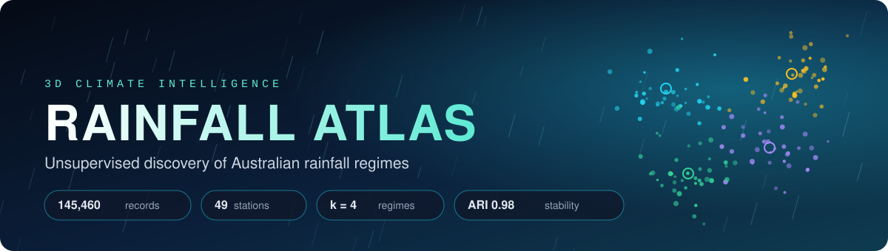
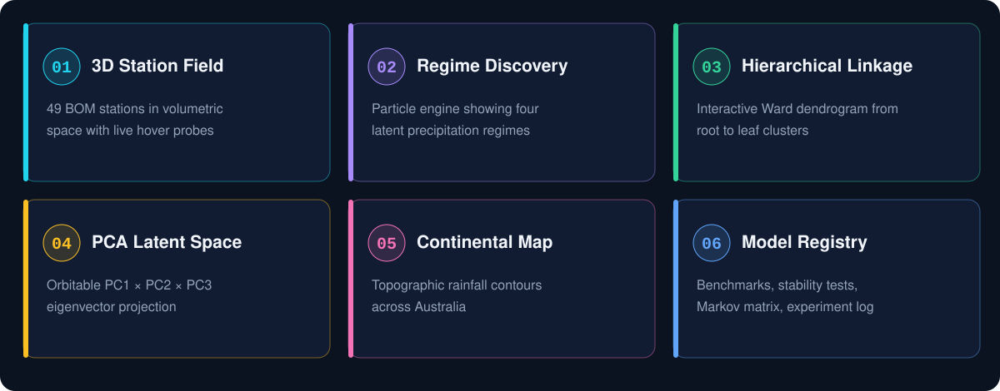
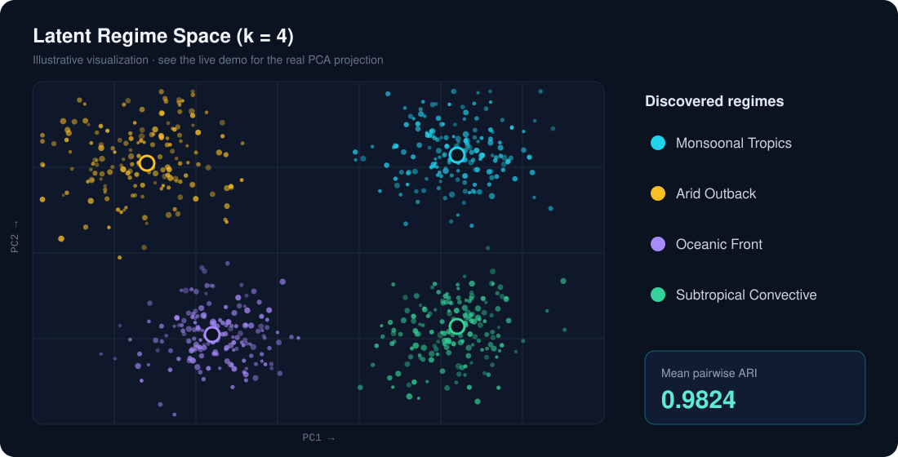
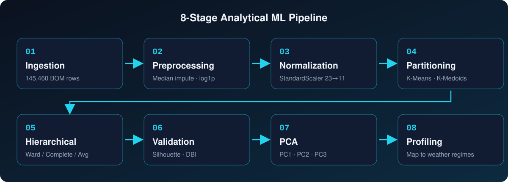

<div align="center">



<br/>

[](https://rainfall-atlas-ca-eo9s.onrender.com)


**Unsupervised discovery of rainfall regimes across Australia, explored through interactive 3D visualizations.**

[Overview](#-project-overview) •
[Screenshots](#-screenshots) •
[Pipeline](#-ml-pipeline) •
[Prerequisites](#-prerequisites) •
[Installation](#-installation) •
[Execution](#%EF%B8%8F-execution)

</div>

---

## 📖 Project Overview

**Rainfall Atlas** is an end-to-end unsupervised machine learning platform that analyses **10 years of Australian Bureau of Meteorology (BOM) observations** to uncover hidden precipitation regimes.

> ⏳ The demo runs on Render's free tier, so the first load can take 30–60 seconds while the server wakes up.

| 📊 Dataset | 🛰️ Stations | 🧩 Optimal k | 🔁 Stability (ARI) | 🌳 Cophenetic Corr. |
|:---:|:---:|:---:|:---:|:---:|
| **145,460** records | **49** BOM stations | **4** regimes | **0.9824** | **0.84** |

### ✨ Key Features



### 🧠 Algorithms and Methods

| Category | Methods |
|---|---|
| **Partition clustering** | K-Means (Euclidean), K-Medoids / PAM (Manhattan) |
| **Hierarchical clustering** | Ward (Euclidean), Complete (Manhattan), Average (Euclidean) |
| **Dimensionality reduction** | Principal Component Analysis (PCA) |
| **Validation** | Silhouette Score, Davies-Bouldin Index, Cophenetic Correlation, ARI, NMI |
| **Temporal analysis** | 1-day Markov transition and persistence matrix |

### 🎯 Discovered Regimes

<div align="center">

</div>

Silhouette peaks mathematically at k = 2 (0.24), which only splits arid inland from coastal maritime. **k = 4** is chosen as the optimal *meteorological* solution because it isolates Tropical Monsoon and subtropical regimes. This yields a more physically interpretable classification of Australian rainfall modes.

---

## 📸 Screenshots

> 💡 Replace the placeholders below with real screenshots from the live app. Save them in `assets/screenshots/` using the file names shown.

<table>
<tr>
<td align="center" width="50%">
<br/>
<b>Landing Page</b>
</td>
<td align="center" width="50%">
<br/>
<b>3D Station Field</b>
</td>
</tr>
<tr>
<td align="center">
<br/>
<b>Regime Discovery</b>
</td>
<td align="center">
<br/>
<b>Hierarchical Dendrogram</b>
</td>
</tr>
<tr>
<td align="center">
<br/>
<b>PCA Latent Space</b>
</td>
<td align="center">
<br/>
<b>Model Comparison Suite</b>
</td>
</tr>
</table>

---

## 🔬 ML Pipeline



<details>
<summary><b>📋 Click for stage-by-stage details</b></summary>

<br/>

1. **Historical Ingestion:** load 145,460 BOM weather records across 49 stations
2. **Preprocessing & Imputation:** median imputation, plus a `log1p` transform to tame rainfall skew
3. **Feature Normalization:** `StandardScaler` on 23 → 11 atmospheric features
4. **Partition Clustering:** multi-restart K-Means and Manhattan K-Medoids across candidate `k`
5. **Hierarchical Linkage:** Ward, Complete and Average agglomeration with dendrogram analysis
6. **Validation Indices:** Silhouette and Davies-Bouldin to evaluate each `k`
7. **PCA Projection:** reduce to PC1, PC2 and PC3 for 3D visualization
8. **Climatological Profiling:** map mathematical centroids back to physical weather regimes

</details>

---

## 🛠️ Tech Stack

| Layer | Tools |
|---|---|
| **ML / Data** | Python, Pandas, NumPy, Scikit-learn, SciPy |
| **Frontend** | HTML, CSS, JavaScript, WebGL 2.0 |
| **Deployment** | Render |

> 📝 *Adjust to your exact stack (e.g. Flask / FastAPI, Three.js, Plotly).*

---

## ✅ Prerequisites

Make sure you have the following installed:

- **Python 3.9+**: [download](https://www.python.org/downloads/)
- **pip**: bundled with Python
- **Git**: [download](https://git-scm.com/downloads)
- A modern browser with **WebGL 2.0** (Chrome, Edge, Firefox or Safari)
- The dataset **`weatherAUS.csv`**: [Kaggle, Rain in Australia](https://www.kaggle.com/datasets/jsphyg/weather-dataset-rattle-package)

---

## 📦 Installation

**1. Clone the repository**

```bash
git clone https://github.com/<your-username>/<your-repo-name>.git
cd <your-repo-name>
```

**2. Create and activate a virtual environment** *(recommended)*

```bash
# macOS / Linux
python3 -m venv venv
source venv/bin/activate

# Windows
python -m venv venv
venv\Scripts\activate
```

**3. Install dependencies**

```bash
pip install -r requirements.txt
```

**4. Add the dataset**

Download `weatherAUS.csv` and place it as shown:

```
<your-repo-name>/
├── data/
│   └── weatherAUS.csv
├── app.py
├── requirements.txt
└── README.md
```

---

## ▶️ Execution

**Run locally**

```bash
python app.py
```

Open your browser at **http://127.0.0.1:5000** *(use the port shown in your terminal if different).*

**Run with Gunicorn** *(production style, same as Render)*

```bash
gunicorn app:app
```

### 🎮 Using the Dashboard

1. Scroll to the **Model Registry** section.
2. Pick an **algorithm**: K-Means, K-Medoids, Ward, Complete or Average.
3. Choose the **mode** (Daily or Monthly) and **k** (2–8).
4. Click **Run Model**.
5. Explore the results in the 3D Regime, Dendrogram, PCA and Map sections.

---

## ☁️ Deployment (Render)

1. Push the project to GitHub.
2. Create a **Web Service** on [Render](https://render.com) and connect the repo.
3. Set **Build Command** to `pip install -r requirements.txt`
4. Set **Start Command** to `gunicorn app:app`
5. Deploy 🚀

---

## 📁 Project Structure

```
├── app.py                # Application entry point / API
├── requirements.txt      # Python dependencies
├── data/
│   └── weatherAUS.csv    # BOM weather dataset
├── static/               # CSS, JS, 3D visualization code
├── templates/            # HTML templates
├── assets/               # README images
│   └── screenshots/
└── README.md
```

> 📝 *Update this tree to match your actual repo.*

---

## 🔮 Future Improvements

- [ ] Add DBSCAN and Gaussian Mixture Models
- [ ] Integrate real-time weather data
- [ ] Supervised rainfall prediction
- [ ] Exportable experiment reports

## 🤝 Contributing

Contributions are welcome! Fork the repo, create a feature branch and open a pull request.

## 📄 License

Distributed under the [MIT License](LICENSE).

## 🙏 Acknowledgements

- [Australian Bureau of Meteorology](http://www.bom.gov.au/) for the weather observations
- [Kaggle: Rain in Australia](https://www.kaggle.com/datasets/jsphyg/weather-dataset-rattle-package) for the dataset

---

<div align="center">

### 👤 Author

**Udit**
B.Tech Robotics & Automation · Lovely Professional University

[](https://github.com/your-username)

⭐ *If you found this project interesting, consider giving it a star!*

</div>
